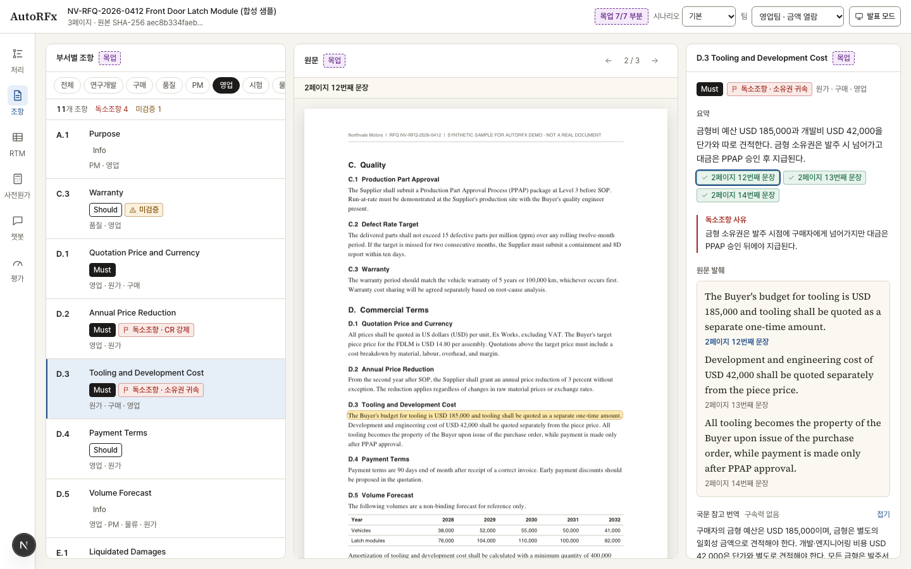
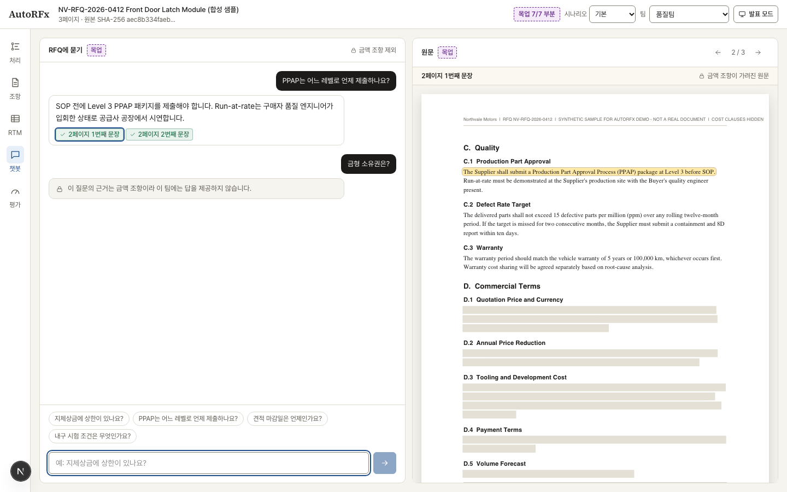

# AutoRFx

> 자동차 부품 협력사(Tier-1/Tier-2)를 위한 다국어 RFQ 분석 · 정밀 Citation 추적 · 사전원가 판단 Agentic RAG 플랫폼  
> **서강대학교 빅데이터종합설계(캡스톤디자인) 3조 × (주)겁쟁이사자들**

---

## 데모 셸 (목업 모드)

지금 저장소에서 돌아가는 것은 **화면과 흐름을 보여주는 데모 셸**입니다. 다른 팀원이 맡은 분석 부분은 아직 목업이고, 모든 화면에 끌 수 없는 **목업** 표시가 붙습니다. 실제 기술 결정은 팀 회의 뒤에 합니다.





```bash
cd web
pnpm install            # PDF.js 워커를 public/으로 복사합니다
pnpm dev                # http://localhost:3000 (개발 실행은 기본이 목업)

pnpm test               # 계약·금액 가림·사전원가 단위 테스트
pnpm test:e2e           # 프로덕션 빌드로 시연 흐름 e2e (320·768·1024·1440 캡처, 접근성 검사)
pnpm fixtures           # 합성 RFQ 원고 → PDF 2종 + 픽스처 재생성 (uv 필요)
pnpm contract:emit      # zod 계약 → /contract/*.schema.json
```

배포용 실행은 모드를 명시해야 시작합니다: `NEXT_PUBLIC_RFQ_MODE=mock pnpm build && pnpm start`. 부분별로 `NEXT_PUBLIC_RFQ_MODE_ANALYSIS=http`처럼 바꾸고 `NEXT_PUBLIC_RFQ_API_BASE`를 주면 그 부분만 백엔드로 갑니다. 주소가 없으면 목업으로 대신하지 않고 그 부분에 오류를 보여줍니다.

| 부분 | 지금 | 비고 |
|---|---|---|
| 문서 정보·처리 진행 | 목업 | 해시와 페이지 수는 합성 PDF의 실제 값 |
| 조항 파싱·분석·번역 | 목업 픽스처 | `web/src/fixtures/sample/manuscript.yaml` (완전한 합성 문서) |
| 인용 검증 | 목업 | 픽스처에 적어 둔 상태이며 실제 검증 결과가 아님 |
| 원문 뷰어 | 합성 PDF와 실제 문장 좌표 | 제한 팀에는 금액 조항을 지운 PDF를 서버가 내려줌 |
| 팀별 금액 가림 | 목업 API가 서버 쪽에서 실제로 거름 | 금액 열람 팀(영업·원가·PM)은 시연용 가정이며 팀 확인 필요 |
| 사전원가 계산 | 목업 API가 십진 연산으로 계산 (`web/src/lib/rfq/mock/precost.ts`) | 입력 후보는 목업, Go/No-Go는 기준선 미정 |
| 챗봇 | 준비된 문답 5개 | 그 밖의 질문에는 답을 지어내지 않음 |
| 평가 | 채점 전 빈 상태 | 예시 수치를 넣지 않음 |

시연은 시작 화면에서 샘플 RFQ를 고른 뒤 처리 진행 → 조항 작업 → RTM → 사전원가 → 챗봇 → 평가 순서로 진행합니다. 상단 바에서 팀을 바꾸면 금액 가림을, 시나리오를 바꾸면 미검증·빈 상태·오류 화면을 보여줄 수 있습니다.

---

## 핵심 설계 원칙

1. **원본 불변 원칙 (Immutable Original)**: 계약 효력을 지닌 RFQ 원문의 텍스트·표·서식을 임의로 변형하지 않고, 원본 문서의 페이지/문장 위치(Locus) 메타데이터를 끝까지 보존합니다.
2. **정밀 Citation Enforcer**: 부서별 요약이나 독소조항 탐지 결과를 클릭하면 원본 문서의 정확한 위치(예: `30페이지 3번째 문장`)를 역추적하여 할루시네이션을 차단합니다.
3. **번역·판별 하이브리드 분업**: 다국어 번역은 전문 번역 레이어로 처리하고, LLM은 문서 정합성 검증·8개 부서 라우팅·RTM(Must/Should/Optional) 판정에 집중합니다.
4. **부서별 권한 분리 (RBAC)**: 연구개발·품질·생산 부서와 구매·재무 부서 간 단가/원가 정보 노출 범위를 제어합니다.
5. **사전원가 (Pre-cost) Go/No-Go 모델**: RFQ 품목·최소 수량·고정비(금형/개발비)·변동비를 기반으로 대략적 단위 원가를 산출해 입찰 참여 의사결정을 지원합니다.

---

## 저장소 구조

```text
AutoRFx/
├── docs/                # 시스템 아키텍처, RTM 평가룰셋 및 회의 설계 문서
├── data/                # 비식별 샘플 메타데이터 및 평가용 Golden Dataset (원본 대용량 파일 Git 제외)
├── src/
│   ├── parser/          # 원본 불변 레이아웃 인식 파서 (PyMuPDF / python-docx)
│   ├── chunker/         # 조항 번호 계층 보존 청커 (Hierarchical Clause Chunker)
│   ├── rag/             # BGE-M3 / OpenAI 임베딩 + ChromaDB + LangGraph 라우터 & Citation Enforcer
│   ├── precost/         # 사전원가(Pre-cost) Go/No-Go 산출 로직
│   └── ui/              # Streamlit 대시보드 (부서별 RBAC 뷰 · RAG 챗봇 · 원가 시뮬레이터)
├── .env.example
└── pyproject.toml
```

---

## 빠른 시작

```bash
# 1. 환경 변수 설정
cp .env.example .env

# 2. 의존성 설치 (uv 기준)
uv sync

# 3. 화면은 web/ (위 "데모 셸" 참고). 백엔드 실행 방법은 팀 회의 뒤 정합니다.
```

---

## 팀 & R&R

자세한 팀원 역할 및 조직 소개는 [Sogang-RFx 프로필 페이지](https://github.com/Sogang-RFx)에서 확인할 수 있습니다.
