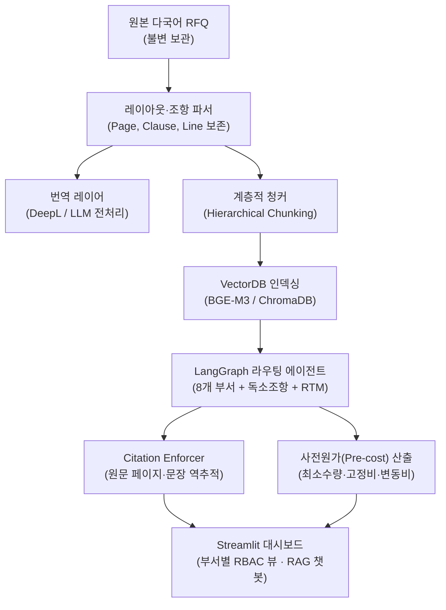

# AutoRFx System Architecture

## 핵심 아키텍처 결정 (ADR 요약)

- **원본 불변성**: 모든 청크는 `source_doc`, `page_number`, `section_id`, `sentence_index`를 메타데이터로 강제 유지합니다.
- **Citation 검증**: 최종 UI 응답은 원문 인덱스 매핑 검증을 통과한 경우에만 출력되며, 출처 확인 실패 시 경고 플래그를 반환합니다.
- **RBAC 단가 마스킹**: 사용자 부서 역할(영업·구매·재무 vs 연구·품질·생산)에 따라 금액·마진 관련 조항 노출을 필터링합니다.
