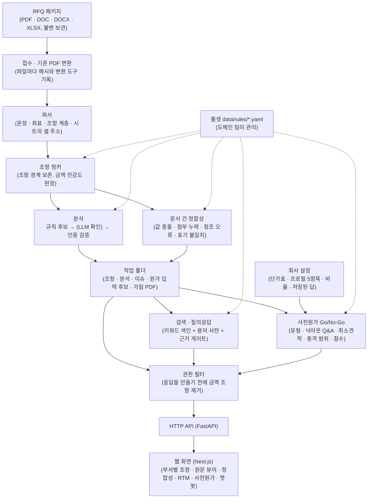

# AutoRFx System Architecture

2026-11-18 기준. `feat/real-pipeline` 브랜치에 구현된 구조다. 화면 스택(Next.js)과 백엔드 방식(FastAPI)은 Tech Lead의 결정이며 팀 합의 전이다.

## 핵심 아키텍처 결정 (ADR 요약)

- **원본 불변성**: 원본 파일은 읽기 전용으로 보관하고 해시로 확인한다. 모든 문장과 조항은 `source_doc`(패키지 안의 파일), `page_number`, `section_id`, `sentence_index`를 메타데이터로 유지한다. 페이지의 기준은 파일마다 만든 기준 PDF다.
- **패키지 단위**: RFQ 한 건은 파일 묶음이다. id는 내용의 해시에서 나오므로 같은 묶음은 같은 결과로 간다.
- **규칙 우선, LLM은 확인**: 부서 분류, 요건 강도, 독소조항은 룰셋이 먼저 판정한다. LLM은 키가 있을 때 애매한 조항만 확인하며, 없어도 끝까지 동작한다. 결과에는 계산한 엔진이 붙는다.
- **Citation 검증**: LLM은 문장 번호로만 인용하고, 코드가 위치를 붙여 원문과 대조한다. LLM이 쓴 숫자는 인용한 문장에 있어야 한다. 검증에 실패한 결과는 다시 시키거나 규칙 결과로 대체한다.
- **RBAC 금액 가림**: 금액 민감 조항은 응답을 만들기 전에 제거한다. 검색 색인, 챗봇, 정합성 이슈, Excel, 원문 PDF(글자 삭제)에 모두 적용한다. 팀을 알 수 없으면 제한 그룹이다.
- **결정적 원가와 판정**: 원가는 `Decimal`로 계산하고 마지막에 한 번 반올림한다. 풀리지 않은 충돌은 가능한 값마다 계산해 가장 불리한 값을 쓰고, 경우가 갈리면 Go/No-Go 대신 보류한다.
- **사전원가 9단계** (`src/autorfx/precost/`): ① RFQ 유형 분류(패턴, 제조·유통·건설·기타) → ② 판정 단위·기준선 → ③ 1차 넉아웃(인증·공정·자격·책임·결제를 회사 프로필과 저장된 답으로 먼저 확인하고, 남은 것만 그 자리에서 예/아니오/모름으로 질문. 모름은 탈락시키지 않고 Go를 조건부로 낮춤) → ④ RFQ 입력 확인(인용 포함) → ⑤ 원가 항목(개당 수량 × 단가, 단가표에서 고름) → ⑥ 수명주기 최소견적(연간 인하를 평균 마진으로 흡수, 원자재 연동이면 재료비는 인하 제외)과 참고 NPV → ⑦ 충격(원자재·유가·환율·금리)과 복합 시나리오로 안전견적, 연동·환율 조항이 있으면 해당 충격 제외, 목표가 < 최소견적이면 가격 넉아웃 → ⑧ 가중 점수 6항목 → ⑨ 판정(Go ≥ 70, 조건부 50~70, No-Go). AI는 분류·위치 지시·제안만 하고 숫자와 판정은 코드가 낸다.
- **회사 설정**: 단가표, 넉아웃 프로필 5항목, 할인율·마진·스크랩·판관비율은 `work/_org/company.json`에 통째로 저장한다. 사실 질문의 예/아니오 답도 여기에 남겨 다음 RFQ에서 다시 묻지 않는다. 금액 열람 팀만 읽고 쓴다.
- **계약**: 화면과 백엔드는 `contract/*.schema.json`만 공유한다. 원천은 `web/src/lib/rfq/contract.ts`이고 백엔드 응답은 이 스키마로 검증된다. 웹은 실제 백엔드로만 동작한다.
- **평가용 세트 보호**: 경로에 `eval`로 시작하는 이름이 있으면 어떤 코드도 읽지 않는다.

## 아직 없는 것

임베딩 검색(ChromaDB), 전용 번역 API, PDF 안의 표 추출, 사용자 인증, 배포 구성. 자세한 목록은 저장소 밖의 작업 문서(TASKS)에 있다.
